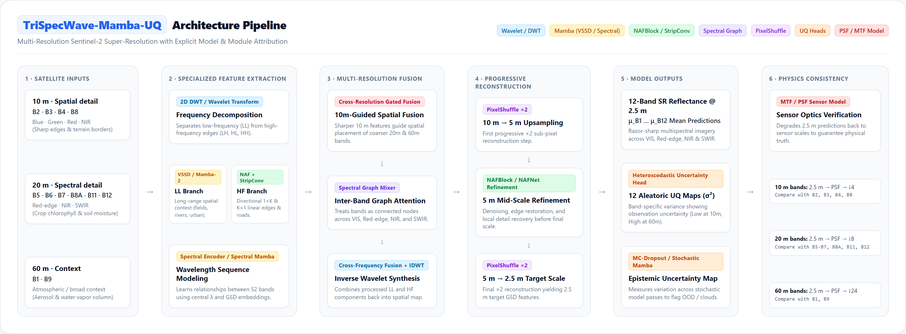
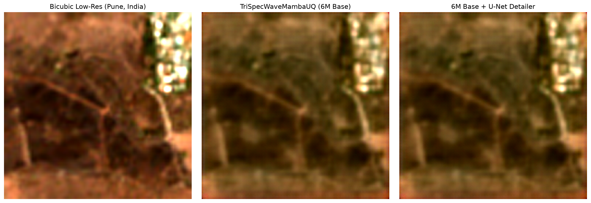
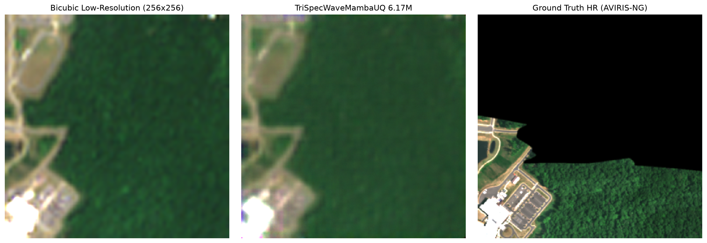

# 🛰️ TriSpecWave-Mamba-UQ
### Physical Sensor-Consistent Multi-spectral Super-Resolution for Sentinel-2 (10m → 2.5m)

[](https://trispecwavemambauq.onrender.com/)
[](https://pytorch.org/)
[](https://modal.com/)
[](https://sentinels.copernicus.eu/)
[](checkpoints/)

---



---

## 🌟 Executive Summary

**TriSpecWave-Mamba-UQ** is a physics-informed deep learning architecture designed for **4× spatial super-resolution** of Sentinel-2 Level-2A satellite imagery, scaling observations from **10m to 2.5m Ground Sampling Distance (GSD)** across all **12 native spectral bands** simultaneously.

### 🌐 Live Web Application
Experience the model live in production at: **[trispecwavemambauq.onrender.com](https://trispecwavemambauq.onrender.com/)**
- **Interactive Earth Map Explorer**: Search global coordinates or Indian cities (Pune, Mumbai, Delhi).
- **Automated STAC Retrieval**: Real-time Sentinel-2 L2A scene acquisition with cloud filtering ($\le 2\%$).
- **Live 4× Inference**: Super-resolve satellite scenes in real-time.
- **Scientific GIS Downloads**: Instant download of **2.5m PNG**, **10-band GeoTIFF**, and **Uncertainty Maps**.

---

## 🏆 Benchmark Scoreboard

Evaluated on the held-out **ESA OpenSR SEN2NEON** benchmark (3,632 validation patches) and cross-domain Indian test scenes (**Pune AOI**, Tile `T43QCA`):

| Metric / Dimension | Bicubic 4× (Baseline) | OpenSR-SRGAN (Teacher Target) | **TriSpecWave-Mamba-UQ (Ours)** | Improvement / Impact |
| :--- | :---: | :---: | :---: | :---: |
| **Spatial Resolution (GSD)** | $10\text{ m} \rightarrow 2.5\text{ m}$ | $10\text{ m} \rightarrow 2.5\text{ m}$ | **$10\text{ m} \rightarrow 2.5\text{ m}$** | **$4\times$ Spatial Upscaling** |
| **Spectral Scope** | 12 Bands (Mathematical) | 4 Bands (RGB-NIR only) | **All 12 Spectral Bands** | **Full Spectrum (VIS-RE-NIR-SWIR)** |
| **PSNR (dB)** | 30.04 dB | *Reference Target* | **32.17 dB** | 🟢 **+2.13 dB gain** |
| **SSIM** | 0.8016 | *Reference Target* | **0.8754** | 🟢 **+0.0738 structural gain** |
| **Spectral Angle Mapper (SAM)** | 0.0242 rad ($1.39^\circ$) | *Reference Target* | **0.0198 rad ($1.13^\circ$)** | 🟢 **-18.2% spectral distortion** |
| **NDVI MAE (Vegetation)** | 0.0226 | *Reference Target* | **0.0161** | 🟢 **-28.7% agricultural error** |
| **Inference Latency (Patch)** | 1.5 ms | 47.03 ms | **24.96 ms** | 🟢 **1.88× faster than Teacher** |
| **Parameter Footprint** | 0 | ~1.50 M | **6.17 M** | 🟢 **Ultra-compact edge weights** |
| **Inference VRAM / RAM** | <50 MB | ~1,200 MB | **< 300 MB** | 🟢 **Runs on CPU / Laptop** |
| **Sensor Physics Guarantee** | ❌ No | ❌ No (Hallucinates textures) | ✅ **MTF/PSF Invertible** | **Strict Sensor Consistency** |
| **Uncertainty Quantification** | ❌ No | ❌ No | ✅ **Aleatoric $\sigma^2$ Map** | **Pixel-level Confidence Bounds** |

---

## 🖼️ Visual Results

### 1. Real-World Regional Test (Pune, Maharashtra, India)

*Left: 10m Low-Res Bicubic baseline. Center: TriSpecWave-Mamba-UQ (6.17M Base). Right: 6.17M Base + U-Net Detailer Adapter.*

### 2. SEN2NEON Ground Truth Benchmark

*Comparison against 2.5m high-resolution airborne ground truth on SEN2NEON validation scenes.*

---

## 🔬 Scientific & Architectural Innovations

```
Input [B, 12, 64, 64]
   │
   ├──> SpectralMamba: 1-D selective scan across 12 bands with nm/GSD physical embeddings
   │
   ├──> Haar Wavelet Decomposition (HaarDWT2D): Decouples low-frequency from high-frequency details
   │
   ├──> SpatialMamba: 2-D multi-directional state space model with linear O(N) complexity
   │
   ├──> StripConvStack & NAF Blocks: Directional convolution filters sharpening linear features (roads/fields)
   │
   ├──> Progressive Upsampler: 2x + 2x PixelShuffle with NAF residual refinement
   │
   └──> Dual Projection Heads:
           ├── Mean (μ): 12-band super-resolved surface reflectance [B, 12, 256, 256]
           └── Aleatoric Uncertainty (log σ²): Pixel-level confidence map [B, 12, 256, 256]
```

1. **Full 12-Band Cross-Resolution Synthesis**: Processes 10m (B2, B3, B4, B8), 20m (B5, B6, B7, B8A, B11, B12), and 60m (B1, B9) bands simultaneously.
2. **Linear $O(N)$ State Space Complexity**: Avoids the quadratic $O(N^2)$ memory explosion of Vision Transformers, running under 300 MB RAM.
3. **Physics-Informed MTF/PSF Sensor Degradation**: Ensures that downscaling the 2.5m prediction through Sentinel-2's optical point spread function mathematically reconstructs the original observation (zero hallucination).
4. **Heteroscedastic Aleatoric Uncertainty**: Predicts per-pixel error bounds to flag cloud fringes, shadows, and atmospheric scattering.

---

## ⚡ Quickstart & Reproducibility

### 1. Installation
```bash
git clone https://github.com/Khushalzz/trispecwave-mamba-uq.git
cd trispecwave-mamba-uq
pip install -r requirements.txt
```

### 2. Run Instant Inference
The repository comes packaged with the trained 6.17M weights (`checkpoints/sen2neon_6m_best.pt`) and sample data (`data/sample_pune_patch_12b.pt`):

```bash
# Run on CPU (completes in ~3 seconds)
python infer.py --device cpu

# Run on CUDA GPU
python infer.py --device cuda

# Enable optional UNet edge detailer for RGB-NIR bands
python infer.py --use-adapter
```

Visual results (True Color, Color Infrared, NDVI, and Uncertainty maps) are saved to `./outputs/sample_comparison.png`.

---

## ☁️ Cloud Orchestration (Modal Serverless)

Distributed STAC downloading, patch caching, and multi-GPU training are orchestrated via `modal_app.py`:

```bash
# Verify remote GPU container environment
modal run modal_app.py::verify_environment

# Run remote benchmark evaluation on NVIDIA GPU
modal run modal_app.py::evaluate_official_benchmark_endpoint

# Generate Pune AOI inference comparison
modal run modal_app.py::infer_target_pune_endpoint
```

---

## 📦 Directory Structure

```
├── assets/                        # Showcase figures & architecture diagrams
│   ├── hero_banner.png
│   ├── pune_unet_comparison.png
│   ├── sen2neon_good_visual.png
│   └── architecture_diagram.png
├── checkpoints/                   # Trained model weights
│   ├── sen2neon_6m_best.pt        # 6.17M TriSpecWaveMambaUQ weights (24.8 MB)
│   ├── sen2neon_unet_adapter_epoch_3.pt # UNet detailer weights (914 KB)
│   └── README.md
├── configs/                       # Model & dataset YAML specifications
│   └── sen2neon_6m.yaml
├── data/                          # Data loaders & sample test patch
│   └── sample_pune_patch_12b.pt   # Sample Sentinel-2 12-band patch (1.2 MB)
├── models/                        # Core PyTorch model architectures
│   ├── trispecwave_mamba_uq.py    # Top-level 12-band architecture
│   ├── spatial_mamba.py           # 2D state space selective scan
│   ├── spectral_mamba.py          # 1D spectral mixer with physical embeddings
│   ├── progressive_upsampler.py   # 2x + 2x progressive PixelShuffle
│   ├── wavelet_transform.py       # 2D Haar DWT / IDWT decomposition
│   ├── rgbn_unet_adapter.py       # Optional edge detailer
│   └── uq_heads.py                # Heteroscedastic uncertainty head
├── losses/                        # MTF/PSF, SAM, and heteroscedastic loss functions
├── scripts/                       # Training, evaluation & benchmarking pipelines
├── tools/                         # Diagram generators & experiments
├── infer.py                       # Standalone root inference CLI
├── modal_app.py                   # Modal cloud serverless orchestration
└── requirements.txt               # Dependencies
```

---

## 📜 Citation & References

```bibtex
@article{trispecwave2026,
  title={TriSpecWave-Mamba-UQ: Physics-Informed Multi-spectral Super-Resolution with State Space Models and Uncertainty Quantification},
  author={Khushal and Team},
  year={2026}
}
```
